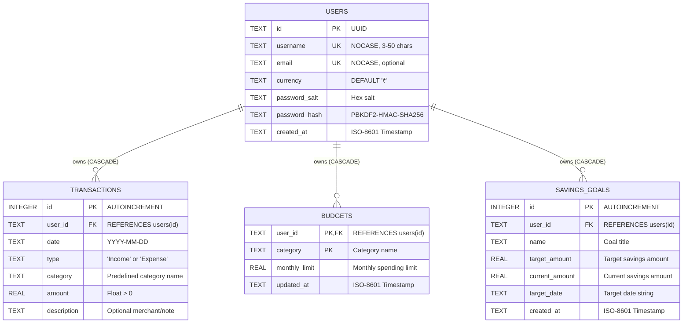

# Comprehensive Codebase Audit Report
# AI-Powered Personal Expense Tracking & Budget Advisor

**Repository:** `TEJAS7356/Personal-Finance-Tracker`  
**Auditor:** Senior Software Engineer, Codebase Auditor & AI Application Architect  
**Audit Date:** October 2026  
**Status:** Audit Completed — Codebase Preserved (No modifications made)

---

## 1. Executive Summary

This audit report evaluates the cloned codebase of **Personal-Finance-Tracker** as the starting foundation for the project: **"AI-Powered Personal Expense Tracking & Budget Advisor"**.

The audited application is a multi-page **Streamlit** web application written in Python 3. It provides personal financial logging, visual analytics, budget tracking, savings goal management, rule-based heuristics, statistical machine learning (trend regression and MAD anomaly detection), and an LLM-powered financial advisor using Google's Gemini API (`google-genai`). Data persistence is handled via a local SQLite database (`finance_tracker.db`) featuring user isolation, password hashing with PBKDF2-HMAC-SHA256, and email-based password recovery via Gmail SMTP.

### Key Audit Findings
1. **Strong Architectural Foundations:** Multi-user data isolation is implemented cleanly at the database level with foreign keys, cascading deletes, and parameterized SQL queries that mitigate SQL injection. Password storage uses cryptographic standards (PBKDF2 with 260,000 iterations and per-user salt).
2. **Critical Runtime Defect in Savings Goals:** In `pages/5_Savings_Goals.py` (Line 61), the call to `add_savings_goal(goal_name.strip(), goal_target, str(goal_date))` passes only 3 arguments, whereas `database.py` requires 4 (`user_id, name, target_amount, target_date`). Any user attempt to create a savings goal crashes with a `TypeError`.
3. **Invalid AI Model Identifier:** In `pages/6_AI_Financial_Advisor.py` (Line 160), the Google GenAI call specifies `model="gemini-3.6-flash"`, which is an invalid model identifier in the Gemini API. When called with a valid API key, the API returns a 404/not found error. Furthermore, multi-turn conversation memory is rendered in the UI but omitted from the model prompt.
4. **Deleted Test Suite:** Forensic Git history inspection revealed that a 5-file unit test suite (`test_user_isolation.py`, `test_password_reset.py`, `test_legacy_migration.py`, `test_finance_tools.py`, `test_finance_ml.py`) existed previously but was deleted in recent commits (`9f3df96` through `1ab8839`), leaving the repo with 0% active automated test coverage.
5. **Environment Dependency Gap:** The active local Python environment (Python 3.13.14) currently does not have the packages listed in `requirements.txt` installed (`streamlit`, `pandas`, `plotly`, `google-genai`, `scikit-learn`, `openpyxl`, `xlrd`, `reportlab`), preventing direct execution until dependencies are installed.
6. **Hardcoded Currency Discrepancy:** While `pages/7_Profile_Settings.py` lets users select currency symbols (`₹`, `$`, `€`, `£`), `utils.format_currency()` and all UI pages hardcode Indian Rupees (`₹` / `Rs. `), ignoring user preference.

---

## 2. Actual Technology Stack

An inspection of the actual source code (rather than claims in documentation) reveals the following active stack:

| Category | Technology / Library | Version Specified | Source Location | Actual Role & Function |
| :--- | :--- | :--- | :--- | :--- |
| **Language** | Python | 3.9+ (Host: 3.13.14) | Repository-wide | Core runtime language. |
| **Application Framework** | Streamlit | `>=1.32.0` | `app.py`, `pages/*.py` | Provides multi-page UI, form processing, session state, and server lifecycle. |
| **Data Processing** | Pandas | `>=2.0.0` | `app.py`, `pages/*.py`, `finance_tools.py`, `finance_ml.py` | DataFrame transformations, aggregations, statement ingestion, CSV exports. |
| **Data Visualization** | Plotly Express & Graph Objects | `>=5.18.0` | `pages/2_Financial_Dashboard.py`, `pages/4_Monthly_Analytics.py` | Renders interactive donut charts, category bar charts, and monthly trend line charts. |
| **Database** | SQLite3 | Python Stdlib | `database.py` | Local relational database stored in `finance_tracker.db` with foreign key enforcement and indexes. |
| **Security & Cryptography** | `hashlib`, `hmac`, `secrets` | Python Stdlib | `database.py`, `auth.py` | PBKDF2-HMAC-SHA256 (260,000 rounds) password hashing; constant-time digest verification; secure OTP generation. |
| **Email / SMTP** | `smtplib`, `email.message` | Python Stdlib | `auth.py` | Delivers 6-digit OTP codes for password recovery over TLS (Gmail port 587). |
| **Machine Learning** | Scikit-learn (`LinearRegression`) | `>=1.4.0` | `finance_ml.py` | Fits ordinary least squares regression over monthly expense totals and per-category totals for next-month forecasting. |
| **Heuristics / Statistics** | Median Absolute Deviation (MAD) | Python & Pandas | `finance_ml.py` | Robust category-wise outlier detection for anomalous transactions (`detect_expense_anomalies`). |
| **Categorization** | Rule-Based Keyword Matcher | Python Stdlib | `finance_ml.py` | Substring keyword lookup mapping merchant/description text to 8 expense categories (`suggest_expense_category`). |
| **Generative AI** | Google GenAI SDK (`google-genai`) | `>=1.0.0` | `pages/6_AI_Financial_Advisor.py` | Invokes Google Gemini API with aggregated financial numbers for conversational financial advice. |
| **File Import** | `openpyxl`, `xlrd` | `>=3.1.0`, `>=2.0.1` | `finance_tools.py` | Parses `.xlsx` and legacy `.xls` bank and card statement uploads. |
| **PDF Generation** | ReportLab | `>=4.0.0` | `finance_tools.py` | Generates formatted A4 downloadable monthly financial PDF reports. |
| **Styling & Theming** | Vanilla CSS (Injected) | Custom | `utils.py` (`inject_css()`) | Glassmorphism design tokens, CSS variables, dark/light theme switching, custom metric cards, badges. |

---

## 3. Project Structure

```
Personal-Finance-Tracker/
├── .git/                               # Git version control metadata
├── .gitignore                          # Ignores db, __pycache__, .env, secrets.toml
├── README.md                           # Documentation and setup instructions
├── requirements.txt                    # Python dependency requirements
├── app.py                              # Application entry point, Quick Add & At-a-Glance
├── auth.py                             # Authentication, session guarding, login/register, OTP reset
├── database.py                         # SQLite schema, connection pool context, CRUD operations
├── finance_ml.py                       # Forecasts, MAD anomaly detection, health scoring, simulator
├── finance_tools.py                    # CSV/Excel statement parser, CSV export, budget alerts, PDF builder
├── utils.py                            # Shared UI styles, CSS injection, theme toggle, categories, formatting
└── pages/
    ├── 1_Transaction_Management.py     # Add/filter/search/delete transactions, statement import, JSON backup/restore
    ├── 2_Financial_Dashboard.py        # Visual charts (pie, bar), KPIs, insights, ML forecasts & anomaly alerts
    ├── 3_Budget_Tracking.py            # Category budget limits, progress bars, budget alerts, PDF download
    ├── 4_Monthly_Analytics.py          # Month-over-month trend charts, delta comparisons, breakdown table
    ├── 5_Savings_Goals.py              # Goal creation, progress updates, remaining amount tracking
    ├── 6_AI_Financial_Advisor.py       # Gemini API chat interface with summarized user financial context
    └── 7_Profile_Settings.py           # User account details, currency selector, account deletion
```

### Detailed File Analysis

| File | Primary Purpose | Key Functions / Classes | Evaluation & Notes |
| :--- | :--- | :--- | :--- |
| `app.py` | Application root and landing page. | Form handling, metrics rendering | Entry point for `streamlit run app.py`. Renders quick-add transaction form and at-a-glance high-level totals. |
| `auth.py` | Authentication & access control. | `require_login()`, `_begin_reset()`, `_verify_otp()`, `_send_otp_email()` | Enforces login on every page. Handles login/register tabs, session state management, and OTP password recovery. |
| `database.py` | Database layer and schema migrations. | `get_connection()`, `create_database()`, `create_user()`, `verify_user()`, `add_transaction()`, `set_budget()`, `add_savings_goal()` | Uses SQLite context manager. Implements cascading deletes, user isolation, and automatic legacy table schema upgrades. |
| `finance_ml.py` | Analytical logic & algorithms. | `predict_next_month_expenses()`, `detect_expense_anomalies()`, `suggest_expense_category()`, `financial_health_score()`, `simulate_finances()` | Pure computation module; receives data structures without querying database directly. Well-isolated. |
| `finance_tools.py` | Document parsing & file generators. | `parse_statement()`, `export_transactions()`, `budget_alerts()`, `build_report_pdf()` | Handles flexible statement imports (CSV/Excel), calculates budget alert thresholds (75%, 100%), builds ReportLab PDF. |
| `utils.py` | Shared UI tokens and formatting. | `inject_css()`, `theme_toggle()`, `format_currency()`, `page_header()`, `metric_card()` | Injects dynamic CSS variables based on active session theme. Declares `INCOME_CATEGORIES` and `EXPENSE_CATEGORIES`. |
| `pages/1_Transaction_Management.py` | Transaction CRUD & Data portability. | Form submissions, search filters, import/export buttons | Comprehensive transaction management page. Includes bank statement import and full JSON backup/restore. |
| `pages/2_Financial_Dashboard.py` | Main financial dashboard. | Plotly figure builders, insight metric builders | Main analytics overview with spending distribution, category bars, ML forecast cards, anomaly list, and simulation controls. |
| `pages/3_Budget_Tracking.py` | Monthly category budget limits. | Form submissions, progress bars | Renders monthly progress against budget limits, alert banners, and a monthly PDF download button. |
| `pages/4_Monthly_Analytics.py` | Historical trends & delta analytics. | Plotly scatter traces, percent change calculations | Renders multi-month income vs. expense line graphs and month-over-month percentage changes. |
| `pages/5_Savings_Goals.py` | Target-based savings tracking. | Goal creation form, progress sliders | **Contains critical runtime bug** on line 61 (`add_savings_goal` called with 3 args instead of 4). |
| `pages/6_AI_Financial_Advisor.py` | LLM financial chatbot. | Gemini client calls, chat rendering | Integrates Google GenAI. **Contains invalid model name** `gemini-3.6-flash`. Does not maintain multi-turn chat history. |
| `pages/7_Profile_Settings.py` | User preferences & account management. | Profile form, account deletion button | Updates username/email/currency. Deletes account with cascading cleanup across transactions, budgets, and goals. |

### Redundant Files, Duplicate Components, and Dependency Anomalies
- **Duplicate Imports / Logic:** `create_database()` is invoked at the top of `app.py` and across multiple pages (`pages/1`, `pages/2`, `pages/3`, `pages/4`, `pages/5`, `pages/6`, `pages/7`). While idempotent (`CREATE TABLE IF NOT EXISTS`), repeated execution adds redundant connection overhead on page reloads.
- **Ignored Currency Setting:** `pages/7_Profile_Settings.py` allows selecting currencies (`₹`, `$`, `€`, `£`), and `database.py` stores it in `users.currency`. However, no other page or utility references `users.currency` — all UI components hardcode `₹` and `Rs. `.
- **Deleted Test Files:** As revealed by Git history, 5 test files were committed and subsequently deleted, leaving the repo without regression testing.

---

## 4. Existing Features Inventory

| Feature | Status | Evidence (Files, Functions, Routes) | Audit Assessment |
| :--- | :--- | :--- | :--- |
| **User Registration** | **Working** | `auth.py`: `_render_login_register()`, `database.py`: `create_user()` | Validates username (3-50 chars), password (>=8 chars), email format; hashes with PBKDF2; prevents duplicates. |
| **User Login & Session Guard** | **Working** | `auth.py`: `require_login()`, `verify_user()` | Checks credentials against salted hash; sets session state; blocks unauthenticated page rendering via `st.stop()`. |
| **Logout** | **Working** | `auth.py`: `_render_account_sidebar()` | Clears `user_id`, `username`, and advisor messages from session state; triggers `st.rerun()`. |
| **Password Reset via OTP** | **Partial** | `auth.py`: `_begin_reset()`, `_verify_otp()`, `_send_otp_email()` | Implementation is complete, but requires live Gmail SMTP app password. Session state reset upon browser reload erases OTP state. |
| **Quick Add Transaction** | **Working** | `app.py`: lines 45-71; `database.py`: `add_transaction()` | Correctly validates positive amount and stores record with active `user_id`. |
| **Transaction History & Filter** | **Working** | `pages/1_Transaction_Management.py`: lines 126-206 | Date range filter, keyword search on category/description, tabular display, and CSV export. |
| **Transaction Deletion** | **Working** | `pages/1_Transaction_Management.py`: line 203; `database.py`: `delete_transaction()` | Deletes record scoped to `user_id` and `transaction_id`. |
| **Transaction Editing** | **Not implemented** | Codebase inspection | No inline or modal editing exists for previously added transactions; users must delete and re-add. |
| **Bank Statement Import** | **Working** | `finance_tools.py`: `parse_statement()`; `pages/1_Transaction_Management.py`: lines 22-36 | Flexible column mapping for CSV/Excel; maps Debit/Credit to Expense/Income; batch inserts into database. |
| **JSON Backup & Restore** | **Working** | `pages/1_Transaction_Management.py`: lines 37-58 | Exports full user portfolio (profile, transactions, budgets, goals) to JSON and restores successfully. |
| **Budget Creation & Tracking** | **Working** | `pages/3_Budget_Tracking.py`; `database.py`: `set_budget()`, `get_budgets()` | Category monthly limits saved to DB; monthly expenses aggregated and rendered via progress bars. |
| **Budget Overrun Alerts** | **Working** | `finance_tools.py`: `budget_alerts()`; `pages/3_Budget_Tracking.py`: line 72 | Identifies categories exceeding 75% (warning) and 100% (over budget) limits for current month. |
| **Savings Goal Creation** | **Broken** | `pages/5_Savings_Goals.py`: line 61 | **CRITICAL BUG:** Calls `add_savings_goal(name, target, date)` missing `user_id`. Throws `TypeError` on form submission. |
| **Savings Goal Update & Delete** | **Working** | `pages/5_Savings_Goals.py`: lines 94-121; `database.py`: `update_savings_goal_amount()` | Correctly updates saved amount and deletes goals. |
| **Financial Dashboard Charts** | **Working** | `pages/2_Financial_Dashboard.py`: lines 56-101 | Interactive Plotly donut chart (expense distribution) and bar chart (spending by category). |
| **Smart Financial Insights** | **Working** | `pages/2_Financial_Dashboard.py`: lines 107-182 | Deterministic spending rate calculations and heuristic recommendation cards based on expense ratio. |
| **Monthly Trend Analytics** | **Working** | `pages/4_Monthly_Analytics.py`: lines 42-130 | Plotly line chart comparing Income vs. Expense over time, with MoM delta percentage changes. |
| **Downloadable PDF Report** | **Working** | `finance_tools.py`: `build_report_pdf()`; `pages/3_Budget_Tracking.py`: line 84 | ReportLab generates formatted A4 PDF containing summary, health score, predictions, alerts, and recent transactions. |
| **AI Expense Categorization** | **Working** | `finance_ml.py`: `suggest_expense_category()` | Keyword-matching heuristic across 8 categories; pre-fills category dropdown in transaction form. |
| **Expense Forecasting (ML)** | **Working** | `finance_ml.py`: `predict_next_month_expenses()` | Scikit-learn Linear Regression over monthly totals; includes holdout MAE when >=3 months of data exist. |
| **Spending Anomaly Detection** | **Working** | `finance_ml.py`: `detect_expense_anomalies()` | Robust Median Absolute Deviation (MAD) flagging expenses exceeding `median + max(3*MAD, 0.75*median, 100)`. |
| **Financial Health Score** | **Working** | `finance_ml.py`: `financial_health_score()` | Deterministic 0–100 score weighted across 5 factors: savings rate (25), ratio (25), budget (20), goals (15), consistency (15). |
| **What-If Financial Simulator** | **Working** | `finance_ml.py`: `simulate_finances()`; `pages/2_Financial_Dashboard.py`: lines 237-262 | Simulates adjustments in monthly savings or specific category reductions and projects goal completion timelines. |
| **AI Financial Advisor Chatbot** | **Partial / Broken** | `pages/6_AI_Financial_Advisor.py`: line 160 | Fails due to invalid model identifier `gemini-3.6-flash`. Lacks multi-turn conversation memory. |
| **Dark/Light Theme Toggle** | **Working** | `utils.py`: `inject_css()`, `theme_toggle()` | Session-state driven CSS variable switching with dynamic Plotly chart color theme adaptation. |
| **Account Deletion Cascade** | **Working** | `pages/7_Profile_Settings.py`; `database.py`: `delete_user_account()` | Deletes user row, triggering SQLite foreign key cascading deletion of all associated transactions, budgets, and goals. |

---

## 5. AI and API Audit

### AI Provider & Model Verification
- **SDK & Provider:** Google GenAI SDK (`google-genai>=1.0.0`) calling Google Gemini.
- **Model Specified:** In `pages/6_AI_Financial_Advisor.py` Line 160:
  ```python
  client = genai.Client(api_key=api_key)
  response = client.models.generate_content(
      model="gemini-3.6-flash",
      contents=full_prompt,
  )
  ```
  **Audit finding:** `"gemini-3.6-flash"` does not exist in Google's model registry. The valid flash models are `gemini-2.0-flash`, `gemini-1.5-flash`, or `gemini-2.5-flash`. Calling this model name produces an API error (`404 NOT_FOUND` or `INVALID_ARGUMENT`).

### Configuration & Key Requirements
- **Key Location:** Looks for environment variable `GEMINI_API_KEY` via `os.environ.get("GEMINI_API_KEY")`, or `.streamlit/secrets.toml` via `st.secrets.get("GEMINI_API_KEY")`.
- **Standalone Execution:** If the key is missing, `pages/6_AI_Financial_Advisor.py` displays a warning and executes `st.stop()`. **All other pages of the application function without an API key.**

### Privacy & Data Transmission Audit
- **Data Sent to AI:** `pages/6_AI_Financial_Advisor.py` constructs a plain-text summary (`data_summary`):
  - Total income, total expenses, and current balance.
  - Category-level expense sums (`Spending by category`).
  - Budget limits and spent amounts.
  - Savings goal targets, current balances, and deadlines.
- **Raw Data Protected:** Raw individual transactions (dates, specific merchant descriptions, itemized costs) are **never sent** to the Gemini API.
- **User Transparency:** The exact text payload sent to the LLM is exposed directly to the user in a collapsible `st.expander("Data being sent to the advisor")`.

### Prompt Architecture & Conversation Memory
- **Stateless Prompting Defect:** While the chat interface stores conversation history in `st.session_state[f"advisor_messages_{user_id}"]` to render chat bubbles on screen, the API prompt sent to Gemini does **not** include previous conversation turns:
  ```python
  full_prompt = (
      f"{system_prompt}\n\n"
      f"Here is a summary of the user's financial data:\n\n{data_summary}\n\n"
      f"User question: {prompt}"
  )
  ```
  Consequently, multi-turn questions (e.g., "Tell me more about the second point you mentioned") fail because the model has no context of previous assistant responses.

### Genuine Machine Learning vs. Heuristics
- **Linear Regression (Genuine ML):** `finance_ml.predict_next_month_expenses()` uses `sklearn.linear_model.LinearRegression` to fit an ordinary least squares model over chronological monthly expenditure totals and per-category totals.
- **Anomaly Detection (Statistical Heuristic):** `finance_ml.detect_expense_anomalies()` uses Median Absolute Deviation (MAD), a robust statistical dispersion metric that prevents outliers from skewing the threshold.
- **Expense Categorization (Deterministic Heuristic):** `finance_ml.suggest_expense_category()` is purely substring keyword matching against `EXPENSE_KEYWORDS` (e.g., checking if "swiggy" or "grocery" appears in the description). There is no NLP embedding model, Naive Bayes classifier, or LLM used for categorization.

---

## 6. Database and Data Flow

### Database Architecture
- **Engine:** SQLite 3 (`finance_tracker.db`), managed via Python's standard `sqlite3` module.
- **Connection Strategy:** Context manager `get_connection()` in `database.py` that opens a fresh connection per operation, sets `PRAGMA foreign_keys = ON`, and guarantees `conn.close()` in a `finally` block.
- **Indexes:**
  - `idx_users_email` ON `users(email)`
  - `idx_transactions_user_date` ON `transactions(user_id, date DESC, id DESC)`
  - `idx_goals_user_id` ON `savings_goals(user_id, id DESC)`
  - `idx_budgets_user_id` ON `budgets(user_id, category)`

### Database Schema



### End-to-End Data Flow Tracing

1. **Adding an Expense:**
   - User enters Date, Category, Amount, and Description in `app.py` or `pages/1_Transaction_Management.py`.
   - UI validates `amount > 0`.
   - Calls `database.add_transaction(user_id, date, "Expense", category, amount, description)`.
2. **Database Persistence:**
   - Inserted into `transactions` table with bound parameters (`?`). Foreign key validation links row to `user_id`. Transaction is committed. Data persists across server restarts in `finance_tracker.db`.
3. **Displaying on Dashboard:**
   - `pages/2_Financial_Dashboard.py` executes `database.get_transactions(user_id)`.
   - SQLite returns only records matching `user_id`, sorted by `date DESC, id DESC`.
   - Transformed into a Pandas DataFrame; filtered by `Type == 'Expense'`.
4. **Calculating Monthly Totals & Category Breakdowns:**
   - Grouping operations: `df.groupby("Category")["Amount"].sum()` generates spending by category.
   - Sum operations: `total_income`, `total_expenses`, and `balance = total_income - total_expenses`.
   - Plotly renders donut chart (`px.pie`) and bar chart (`px.bar`).
5. **Sending Financial Data to AI Advisor:**
   - In `pages/6_AI_Financial_Advisor.py`, `get_transactions(user_id)`, `get_budgets(user_id)`, and `get_savings_goals(user_id)` are queried.
   - Totals and category aggregates are serialized into a multi-line formatted string (`data_summary`).
6. **Generating & Displaying AI Recommendation:**
   - Prompt string composed with system guidelines, `data_summary`, and user question.
   - Dispatched via `client.models.generate_content()`.
   - Assistant response is displayed via `st.chat_message("assistant")` and appended to session state.

### Security and Data Isolation Analysis
- **SQL Injection:** **Zero vulnerabilities found.** All queries use parameterized SQL placeholders (`?`). No dynamic SQL string interpolation exists.
- **Cross-User Data Isolation:** Queries across all tables include explicit `WHERE user_id = ?` clauses. Primary key on `budgets` is composite `(user_id, category)`. Foreign keys enforce `ON DELETE CASCADE`.
- **Password Security:** PBKDF2 with 260,000 iterations and 16-byte random salt prevents rainbow table attacks. Comparison uses `hmac.compare_digest` to prevent timing attacks.
- **Account Enumeration Defense:** The password reset flow in `auth.py` outputs the exact same message regardless of whether an email address exists in the database.

---

## 7. UI and UX Audit

### Design System & Aesthetics
- **Theme Architecture:** `utils.py` implements a dual-mode CSS variables system (`--pft-bg`, `--pft-glass-bg`, `--pft-text-primary`, `--pft-header-grad`).
- **Typography:** Configured to `'Inter', 'Segoe UI', sans-serif` via custom styles.
- **Visual Style:** Glassmorphic card styling (`backdrop-filter: blur(10px)`), gradient titles, soft colored metric top-borders (`accent-violet`, `accent-teal`, `accent-amber`, `accent-rose`).
- **Charts:** Plotly charts are styled with dynamic transparent backgrounds (`paper_bgcolor="rgba(0,0,0,0)"`) and palette colors matching the active theme (`FINANCE_COLOR_SEQUENCE`).

### UI/UX Flaws & Usability Bottlenecks

1. **Transaction Table Layout on Mobile:**
   - `pages/1_Transaction_Management.py` renders rows using 7 Streamlit columns:
     ```python
     st.columns([0.6, 1, 1, 1.3, 1.3, 2.3, 0.7])
     ```
   - On mobile screens (< 768px), Streamlit collapses multi-column layouts into vertically stacked rows, resulting in an unreadable transaction history.
2. **Ignored Currency Setting:**
   - Setting a preferred currency in `pages/7_Profile_Settings.py` has no effect across the app. `format_currency()` hardcodes `"Rs. "`, while column labels hardcode `"₹"`.
3. **Hardcoded Categories:**
   - Categories are statically hardcoded in `utils.py` (`INCOME_CATEGORIES` has 5 items; `EXPENSE_CATEGORIES` has 9 items). Users cannot define custom categories (e.g., "Pets", "Subscriptions", "Taxes").
4. **Ephemeral Session Resets:**
   - State stored in `st.session_state` (such as the active theme, temporary success notices, and the password reset OTP hash) is lost whenever the browser tab is refreshed.
5. **No Inline Transaction Editing:**
   - To correct a typo in amount or category, users must delete the record and recreate it.

---

## 8. Dependencies and Project Execution

### Dependency Review (`requirements.txt`)

```text
streamlit>=1.32.0
pandas>=2.0.0
plotly>=5.18.0
google-genai>=1.0.0
scikit-learn>=1.4.0
openpyxl>=3.1.0
xlrd>=2.0.1
reportlab>=4.0.0
```

### Diagnostic Findings
- **Host Runtime:** Python 3.13.14 on Windows.
- **Current State:** None of the packages from `requirements.txt` are currently installed in the global Python environment.
- **Execution Diagnostic:** Running `python -c "import streamlit"` fails with:
  ```text
  ModuleNotFoundError: No module named 'streamlit'
  ```
- **Installation Safety:** Under current audit rules, packages were not installed globally. To run the project, dependencies must be installed in an isolated virtual environment.

### Setup and Startup Instructions

```bash
# 1. Navigate to the project root
cd Personal-Finance-Tracker

# 2. Create an isolated virtual environment
python -m venv .venv

# 3. Activate the virtual environment (Windows PowerShell)
.venv\Scripts\Activate.ps1

# 4. Install all required dependencies
pip install -r requirements.txt

# 5. (Optional) Configure Gemini API Key and Gmail SMTP for Password Reset
# Create .streamlit/secrets.toml:
# GEMINI_API_KEY = "your-gemini-api-key"
# SMTP_USERNAME = "your-email@gmail.com"
# SMTP_APP_PASSWORD = "your-gmail-app-password"

# 6. Launch the application
streamlit run app.py
```

---

## 9. Testing and Verification Results

### Static Syntax & Compilation Verification
All 13 Python files in the repository were compiled using Python's standard `py_compile` module:
```bash
python -c "import py_compile, glob; [py_compile.compile(f, doraise=True) for f in glob.glob('*.py') + glob.glob('pages/*.py')]; print('All files compiled successfully!')"
```
**Result:** **100% Passed.** No syntax errors, tokenization errors, or indentation errors exist in any file.

### Functional Verification & Bug Replication
Using isolated in-memory/temporary SQLite databases, core backend modules were verified:
1. **User Authentication & Isolation (`database.py`):** Verified. Creating `alice` and `bob`, adding transactions, and checking cross-user deletion verified that users cannot view or delete each other's data.
2. **Savings Goal Defect Replication:** Executed `database.add_savings_goal('Emergency Fund', 10000.0, '2026-12-31')` with 3 arguments (matching `pages/5_Savings_Goals.py` line 61).
   **Result:** Raised `TypeError: add_savings_goal() missing 1 required positional argument: 'target_date'`. This confirms the runtime defect in savings goals.

### Test Suite Forensic Discovery
Git log inspection revealed that automated test files were committed and subsequently deleted in commits `9f3df96` through `1ab8839`:
- `test_user_isolation.py` (Deleted in `1ab8839`): Tested two-user isolation across transactions, budgets, goals, and deletion.
- `test_password_reset.py` (Deleted in `9b7c343`): Tested password reset database updates and hash replacements.
- `test_legacy_migration.py` (Deleted in `bf5dc6d`): Tested automatic schema migration of single-user legacy databases.
- `test_finance_tools.py` (Deleted in `f7096ff`): Tested CSV statement parsing, budget alert triggers, and PDF document generation.
- `test_finance_ml.py` (Deleted in `9f3df96`): Tested regression predictions, anomaly detection, health scoring, simulation, and categorization.

**Current Test Coverage:** **0%** (no active test files exist in the repository).

---

## 10. Bugs, Risks, and Technical Limitations

### Critical Severity Bugs
1. **Savings Goal Creation Crash:**
   - **File:** `pages/5_Savings_Goals.py` (Line 61)
   - **Defect:** `add_savings_goal(goal_name.strip(), goal_target, str(goal_date))` passes 3 arguments. `database.py` requires 4 (`user_id, name, target_amount, target_date`).
   - **Impact:** Submitting the form throws an unhandled `TypeError` in the Streamlit UI.
2. **Invalid Gemini Model Name:**
   - **File:** `pages/6_AI_Financial_Advisor.py` (Line 160)
   - **Defect:** Model string is set to `model="gemini-3.6-flash"`.
   - **Impact:** Google GenAI API throws an HTTP 404 / `NotFound` exception on every prompt.

### Moderate Severity Bugs & Limitations
3. **Stateless AI Chat History:**
   - `pages/6_AI_Financial_Advisor.py` does not pass past messages in `st.session_state[f"advisor_messages_{user_id}"]` to the Gemini API, breaking conversational continuity.
4. **Currency Settings Ineffective:**
   - `users.currency` stored in the database is completely ignored by `utils.format_currency()` and all page templates, which hardcode `"Rs. "` and `"₹"`.
5. **No Transaction Editing:**
   - Users cannot edit existing transactions. Misclassified or mistyped transactions require manual deletion and re-entry.
6. **Password Reset Lost on Browser Reload:**
   - OTP hash and reset state are stored only in `st.session_state`. Refreshing the page during password reset wipes the state and forces the user to start over.
7. **SQLite Concurrency & Multi-Tenancy:**
   - SQLite uses file-level locking for writes. If multiple users execute simultaneous write operations, database locks (`sqlite3.OperationalError: database is locked`) may occur.

---

## 11. Recommended Future Features

| Feature | Already Exists? | Additional Work Required | Existing Files Impacted | Dependencies / API / Cost | Difficulty | Priority |
| :--- | :--- | :--- | :--- | :--- | :--- | :--- |
| **Fix Savings Goal & AI Model Bugs** | Buggy | Fix parameter mismatch in `pages/5` line 61; change model to `gemini-2.0-flash` or `gemini-1.5-flash` in `pages/6`. | `pages/5_Savings_Goals.py`, `pages/6_AI_Financial_Advisor.py` | None | Easy | **High** |
| **Restore Automated Test Suite** | Deleted | Recreate `tests/` directory and restore the 5 deleted unit test scripts with pytest runner. | New `tests/` folder | `pytest` | Easy | **High** |
| **Conversational Multi-Turn AI Memory** | Partial | Send conversation history in `client.chats.create()` or pass formatted dialog history. | `pages/6_AI_Financial_Advisor.py` | None | Medium | **High** |
| **Transaction Inline Editing** | No | Add edit modal or expander form with `update_transaction()` SQL helper. | `database.py`, `pages/1_Transaction_Management.py` | DB helper | Medium | **High** |
| **UPI & Bank Statement Auto-Parser** | Partial (Generic CSV) | Specialized parsers for PhonePe, GPay, Paytm, and Indian bank CSV/PDF statements. | `finance_tools.py`, `pages/1_Transaction_Management.py` | `pdfplumber` (for bank PDFs) | Medium | **High** |
| **Dynamic Currency Localization** | Partial (DB only) | Connect `users.currency` to `format_currency()` and replace hardcoded `₹` labels. | `utils.py`, `app.py`, all `pages/*.py` | None | Easy | **High** |
| **Custom Category Taxonomy** | No | Add `categories` table per user, allowing custom category additions, edits, and deletions. | `database.py`, `utils.py`, `pages/1`, `pages/3`, `pages/7` | SQLite schema migration | Medium | **Medium** |
| **Budget Overrun Forecast & Alerts** | Partial | Daily burn-rate calculations projecting end-of-month budget breaches before they happen. | `finance_ml.py`, `pages/3_Budget_Tracking.py`, `app.py` | None | Medium | **Medium** |
| **Recurring Subscriptions Tracker** | No | Detect repeating monthly transactions (rent, Netflix, SIPs) and project upcoming dues. | `finance_ml.py`, `database.py`, `pages/2_Financial_Dashboard.py` | SQLite schema addition | Medium | **Medium** |
| **Hybrid Intelligent Categorization** | Heuristic only | Combine fast local keyword matching with fallback to local classifier or Gemini categorization for unknown merchants. | `finance_ml.py`, `pages/1_Transaction_Management.py` | Optional Gemini call | Medium | **Medium** |
| **Mobile-Responsive Data Cards** | No | Replace 7-column layout in transaction history with responsive card components. | `utils.py`, `pages/1_Transaction_Management.py` | CSS updates | Easy | **Medium** |
| **Cloud Database Migration (PostgreSQL)** | No | Migrate SQLite layer to PostgreSQL (via SQLAlchemy or Supabase) for robust concurrent multi-user deployment. | `database.py` | PostgreSQL / Supabase | Hard | **Low** |

---

## 12. Prioritized Implementation Roadmap

### Phase 1: Critical Stability & Core Fixes (Immediate)
- **Step 1.1:** Fix `pages/5_Savings_Goals.py` line 61 by passing `user_id`:
  ```python
  add_savings_goal(user_id, goal_name.strip(), goal_target, str(goal_date))
  ```
- **Step 1.2:** Fix `pages/6_AI_Financial_Advisor.py` line 160 by updating the model name to `gemini-2.0-flash` or `gemini-1.5-flash`.
- **Step 1.3:** Restore the unit test suite into a formal `tests/` directory (`test_user_isolation.py`, `test_password_reset.py`, `test_finance_tools.py`, `test_finance_ml.py`).
- **Step 1.4:** Standardize currency formatting so `format_currency(amount, currency_symbol)` dynamically honors the user's selected preference.

### Phase 2: User Experience & Data Management (Near-Term)
- **Step 2.1:** Implement transaction editing (`edit_transaction()`) in `database.py` and `pages/1_Transaction_Management.py`.
- **Step 2.2:** Redesign the transaction history table for mobile responsiveness using adaptive glassmorphic list cards instead of 7 rigid Streamlit columns.
- **Step 2.3:** Add user-defined custom categories with a database-backed taxonomy.
- **Step 2.4:** Implement Indian UPI statement import parsers (supporting PhonePe, Google Pay, and Paytm statement exports).

### Phase 3: Advanced AI & Proactive Analytics (Mid-Term)
- **Step 3.1:** Implement multi-turn conversational chat sessions in `pages/6_AI_Financial_Advisor.py` using `client.chats.create()`.
- **Step 3.2:** Enhance categorization with hybrid AI: match against fast local keywords first, with optional LLM fallback for ambiguous merchant narrations.
- **Step 3.3:** Build proactive budget pacing: calculate current-month daily burn rates and display warnings if spending will cause an overrun before month-end.
- **Step 3.4:** Add recurring transaction detection to automatically identify recurring monthly bills, utilities, and SIP investments.

### Phase 4: Production Architecture & Scaling (Long-Term)
- **Step 4.1:** Migrate SQLite storage to a client-server database (e.g. PostgreSQL / Supabase) to support multi-user concurrency and cloud deployments.
- **Step 4.2:** Introduce secure cookie-based or JWT session tokens to prevent session loss on page refreshes.

---

## 13. File Preservation & Modification Guidance

### Files to Preserve Carefully (High Stability / Low Modification)
- `database.py`: Core database schema, migration logic, and PBKDF2 cryptography are secure and well-structured. Core CRUD signatures should be maintained for backward compatibility.
- `auth.py`: Authentication session guard, constant-time hash comparisons, and account enumeration defenses are implemented cleanly.

### Files Requiring Modification for Enhancements
- `pages/5_Savings_Goals.py`: **Immediate modification required** to resolve the `add_savings_goal` parameter bug.
- `pages/6_AI_Financial_Advisor.py`: **Immediate modification required** to fix the model name (`gemini-2.0-flash`) and implement multi-turn chat memory.
- `utils.py`: Requires updates to support dynamic currency symbols from user profiles and responsive CSS layouts.
- `pages/1_Transaction_Management.py`: Requires updates for transaction editing, mobile card styling, and UPI statement import.
- `finance_ml.py`: Requires enhancements for daily burn rate projections and recurring subscription detection.
- `finance_tools.py`: Requires new parsing routines for Indian UPI statement formats.

---
*End of Audit Report.*
